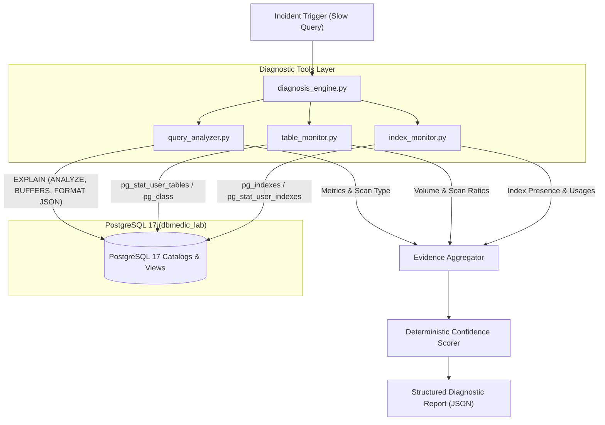

# DBMedic Diagnostic Engine (Phase 2)

## 1. Diagnostic Architecture

DBMedic's Diagnostic Engine investigates database performance incidents deterministically, without requiring or invoking language models during tool execution. In Phase 2, the engine focuses on identifying query regressions, missing secondary indexes, and inefficient scan patterns against PostgreSQL 17 (`dbmedic_lab`).



---

## 2. Tool Responsibilities

| Module | File | Primary Responsibility |
| :--- | :--- | :--- |
| **Query Analyzer** | `agent/tools/query_analyzer.py` | Retrieves execution plans using `EXPLAIN (FORMAT JSON)` and actual performance metrics via `EXPLAIN (ANALYZE, BUFFERS, FORMAT JSON)` for registered templates. Parses tree nodes to detect `Seq Scan`, `Index Scan`, planning/execution times, and buffer hits. |
| **Table Monitor** | `agent/tools/table_monitor.py` | Queries table-level metrics, relation sizes, dead tuple bloat, and historical scan ratios (`seq_scan` vs `idx_scan`). Validates all table names against a strict immutable allowlist. |
| **Index Monitor** | `agent/tools/index_monitor.py` | Inspects index definitions, leading columns, uniqueness, and operational usage stats. Evaluates whether filter columns (e.g. `orders.customer_id`) are covered by a suitable leading index. |
| **Diagnosis Engine** | `agent/core/diagnosis_engine.py` | Correlates findings from all three modules, computes selectivity, calculates deterministic confidence (0.0 to 1.0), and formats the standardized incident diagnosis report. |

---

## 3. PostgreSQL System Catalogs & Statistics Views

The diagnostic tools extract operational metrics directly from PostgreSQL system catalogs and statistics views:

1. **`pg_stat_user_tables`**:
   - `seq_scan`: Total count of sequential scans initiated on the table.
   - `seq_tup_read`: Total number of live rows fetched by sequential scans.
   - `idx_scan`: Total count of index scans initiated on the table.
   - `idx_tup_fetch`: Total live rows fetched by index scans.
   - `n_dead_tup`, `n_live_tup`: Dead vs live tuple estimates to detect bloat.

2. **`pg_class` & `pg_namespace`**:
   - `reltuples`: Planner's estimate of the total row count in the relation.
   - `relpages`: Disk page count allocated to the relation.
   - `pg_total_relation_size(oid)`: Total disk size including heap, toast, and indexes.
   - `pg_relation_size(oid)`: Heap table disk size.
   - `pg_indexes_size(oid)`: Combined index disk size.

3. **`pg_indexes` & `pg_stat_user_indexes`**:
   - `pg_indexes.indexdef`: Full DDL definition of the index.
   - `pg_indexes.indexname`: Index identifier.
   - `pg_stat_user_indexes.idx_scan`: Number of times an index was scanned.
   - `pg_index.indkey` & `pg_attribute.attname`: Maps index key numbers to column names to determine the index's leading key column.

---

## 4. Execution Plan Interpretation

When PostgreSQL plans a query like `SELECT COUNT(*) FROM orders WHERE customer_id = 4242`:

- **Missing Index (Incident State)**:
  - Planner chooses **`Seq Scan`** on `orders`.
  - Node filter: `(customer_id = 4242)`.
  - Every page and row in the 200,000-row table must be fetched into memory (high buffer hits/reads) and tested against the filter.
  - Typical wall-clock execution time: 15–30 ms.

- **Index Present (Remediated State)**:
  - Planner chooses **`Index Scan`** (or `Bitmap Index Scan` / `Bitmap Heap Scan`) using `idx_orders_customer_id`.
  - Index condition: `(customer_id = 4242)`.
  - Only the B-tree leaf pages matching the customer ID and corresponding table heap pages are fetched.
  - Typical wall-clock execution time: < 1 ms (90%+ latency reduction).

---

## 5. Diagnosis Logic & Confidence Scoring

The diagnosis engine uses multi-factor deterministic logic to evaluate whether a slow query is caused by a missing index:

$$\text{Confidence} = w_{\text{scan}} + w_{\text{index}} + w_{\text{selectivity}} + w_{\text{latency}} + w_{\text{history}}$$

| Condition | Weight | Rationale |
| :--- | :--- | :--- |
| **`scan_type == 'Seq Scan'`** | `+0.30` | Direct planner observation that all rows are scanned sequentially. |
| **No suitable index on filter column** | `+0.30` | Catalog inspection confirms `orders(customer_id)` lacks a leading index. |
| **High selectivity on large table** | `+0.25` | Matched rows / total rows $\le 5\%$ on a table with $> 1,000$ rows. |
| **Execution time $\ge 5.0\text{ ms}$** | `+0.10` | Observed latency exceeds benchmark threshold for a point query. |
| **Historical sequential scan activity** | `+0.05` | Table statistics confirm repeated full scans in production/benchmark. |

If the table is small ($< 1,000$ rows), a sequential scan is often faster than an index scan; in that case, confidence is reduced and `root_cause` is classified as `small_table_scan` rather than `missing_suitable_index`.

---

## 6. Safety Restrictions

DBMedic enforces strict database safety rules:

1. **Protocol-Level Read-Only Default**:
   All diagnostic connections default to `options="-c default_transaction_read_only=on"`. Any accidental DDL/DML attempt raises an immediate PostgreSQL error.
2. **Template Whitelisting**:
   `query_analyzer.py` never accepts arbitrary SQL strings from callers or models. Only registered templates (`REGISTERED_QUERY_TEMPLATES`) with parameter bindings are executed.
3. **Identifier Allowlisting**:
   Table names are validated against `ALLOWED_TABLES` (`customers`, `products`, `orders`, `order_items`). Index names must conform to `^[a-zA-Z_][a-zA-Z0-9_]{0,62}$`.
4. **Remediation Gating**:
   Diagnostic tools NEVER execute `CREATE INDEX` or `DROP INDEX`. Recommendations include `"requires_approval": true`, keeping remediation isolated from investigation.
5. **Credential Protection**:
   Connection strings, passwords, and user credentials are sanitized and never written to logs or stdout.

---

## 7. How to Run the Tests

To run all Phase 2 diagnostic and Phase 1 scenario tests:

```powershell
python -m pytest tests/ -v
```

To run only the Phase 2 diagnostic engine tests:

```powershell
python -m pytest tests/test_query_analyzer.py tests/test_table_monitor.py tests/test_index_monitor.py tests/test_diagnosis_engine.py -v
```

To run the complete diagnostic runner:

```powershell
python scripts/run_diagnostics.py
```

